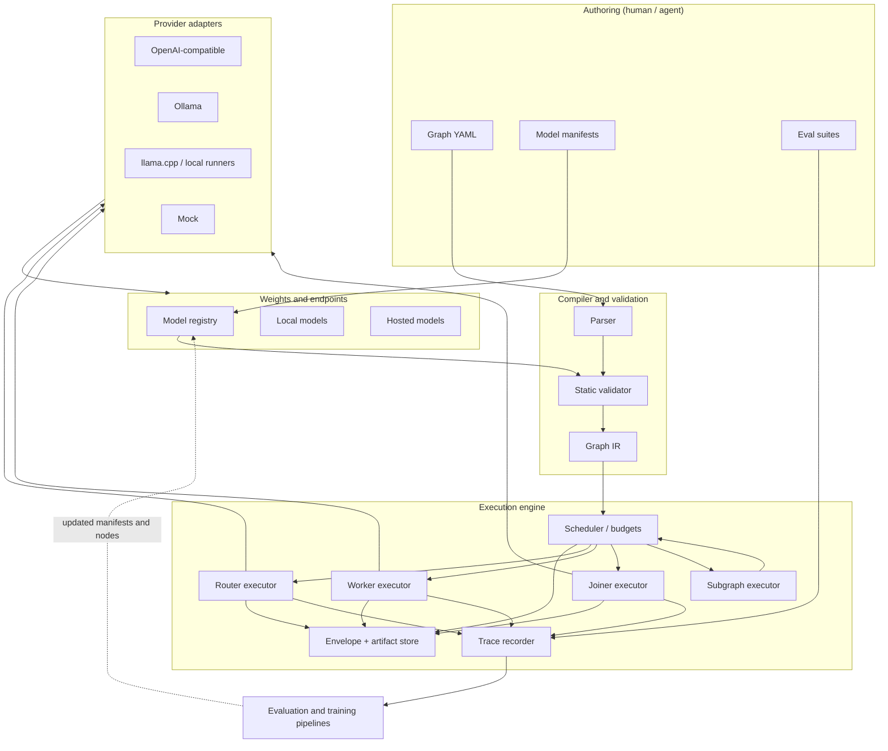
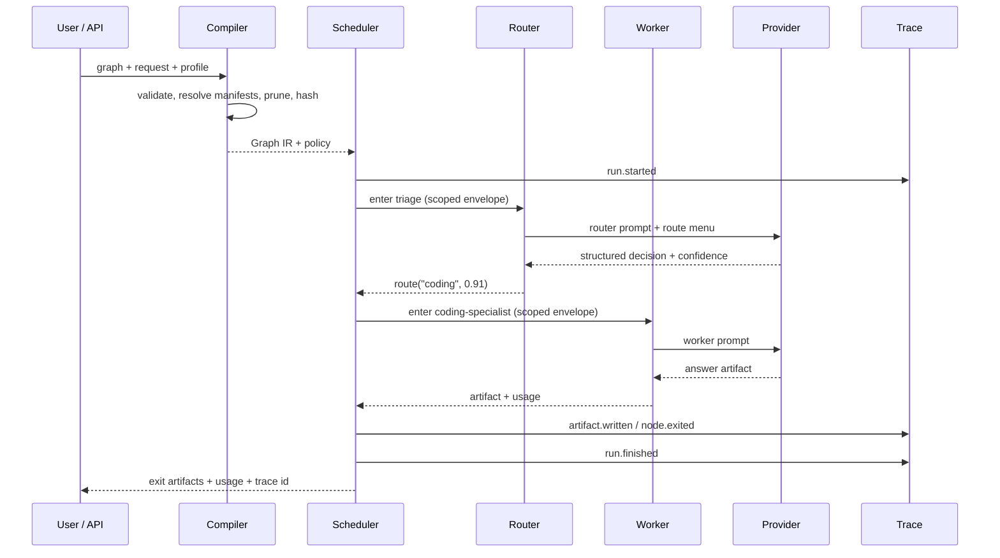

# Architecture

This document describes the system as a set of layers with explicit contracts. It is
normative unless a linked ADR says otherwise. Implementation status lives in
[`../.scratch/tickets/BOARD.md`](../.scratch/tickets/BOARD.md), not here.

## Contents

1. [System overview](#1-system-overview)
2. [Layers and components](#2-layers-and-components)
3. [The four data contracts](#3-the-four-data-contracts)
4. [Request lifecycle](#4-request-lifecycle)
5. [Runtime state and failure domains](#5-runtime-state-and-failure-domains)
6. [Storage and on-disk layout](#6-storage-and-on-disk-layout)
7. [Deployment modes](#7-deployment-modes)
8. [Extensibility points](#8-extensibility-points)
9. [Quality attributes](#9-quality-attributes)
10. [Decision index](#10-decision-index)

## 1. System overview



The architecture is deliberately boring: a compiler, a scheduler, a small set of node
executors, and provider adapters. The novelty is in the contracts, not in exotic
machinery.

## 2. Layers and components

### 2.1 Authoring layer

- **Graph YAML** (`apiVersion: modelgraph/v0`, `kind: Graph`). Human-readable,
  git-friendly, statically checkable.
- **Model manifests** (`kind: Model`) pin provider, version, limits, cost, license, and
  provenance. Graphs reference model IDs; they never embed endpoints or secrets.
- **Eval suites** are versioned alongside the graph and the model. They are inputs to
  gating, not an afterthought.
- **Run profiles** (later) select capabilities and budgets without editing the graph:
  `--profile local-8gb`, `--profile no-network`, `--profile commercial-ok`.

### 2.2 Compiler and validation

| Component | Responsibility | Failure behavior |
| --- | --- | --- |
| Parser | YAML → JSON-compatible document; duplicate-key detection. | Hard error with file and path. |
| Schema validation | Structural checks against `schemas/graph.schema.json`. | Hard error list, no execution. |
| Static validator | Semantic checks: unique IDs, edge endpoints, acyclicity, reachability, artifact availability, routing edges, registry resolution. | Errors block; warnings are reported and can be promoted to errors in CI. |
| Compiler | Resolve manifests, expand defaults, produce a self-contained Graph IR with hashes and a stable node order. | Deterministic output; same input → same hash. |
| Pruner | Apply a capability filter and remove unreachable/unsupported subgraphs. | Produces a PruneReport; never silently changes semantics. |

The Graph IR is the runtime's only input. The runtime never re-reads YAML, so a run can
be reproduced from the IR plus pinned manifests.

### 2.3 Execution engine

- **Scheduler** walks the graph one node at a time in v0. It is written as a frontier so
  fan-out can be added without rewriting it ([T-0018](../.scratch/tickets/T-0018-fanout-ensemble.md)).
- **Envelope** is the request-scoped state: inputs, artifacts, budget, path, and
  provenance. It is *not* the full prompt; each node gets a scoped render of it.
- **Executors** are separate for router, worker, joiner, and subgraph because their
  contracts differ. They share the provider call path, budget accounting, and tracing.
- **Trace recorder** writes append-only events with content-addressed artifacts. Replay
  consumes the trace, not the network.
- **Budget accountant** owns steps, depth, tokens, cost, and wall time. It can veto a
  call before it is made.

### 2.4 Provider layer

A provider adapter translates a normalized chat request into a vendor-specific call and
normalizes the response, usage, and errors. Adapters do not know about graphs, routing,
or envelopes. The same adapter can serve many nodes.

Required adapter surface for v0:

```text
capabilities() -> {chat, json_mode, streaming, max_context, cost_model}
chat(request)   -> {text, usage, finish_reason, raw_meta}
health()        -> {ok, model_loaded, detail}
```

The adapter contract is specified in [protocol.md](protocol.md#9-provider-adapter-contract).

### 2.5 Model registry

A local-first directory of model manifests, keyed by `id@version`. It resolves a graph's
model references, provides routing metadata (cost, latency, context), and enforces
license and resource filters. It never stores weights; it stores pointers, hashes, and
provenance. A registry may be a directory in the repo, a user-level cache, or a future
remote index ([T-0026](../.scratch/tickets/T-0026-model-registry.md)).

### 2.6 Evaluation and training

These are offline systems that consume traces and produce artifacts:

```text
traces + suites ──▶ node evals ──▶ routing metrics ──▶ e2e Pareto report
       │                  │
       ├──▶ dataset export ──▶ router training ──▶ calibrated router node
       └──▶ failure slices ──▶ specialist training (SFT/LoRA/distill) ──▶ model card
```

Training never mutates a graph in place. It produces a new model version and an eval
report; promotion is a separate, gated step.

## 3. The four data contracts

Everything else is implementation detail. These four shapes are what tools, agents, and
contributors work against.

| Contract | Schema | Owner | Mutability |
| --- | --- | --- | --- |
| **Graph** | [`schemas/graph.schema.json`](../schemas/graph.schema.json) | Graph author | Versioned in git; compiled to IR |
| **Model manifest** | [`schemas/model-manifest.schema.json`](../schemas/model-manifest.schema.json) | Model contributor / operator | Immutable per version |
| **Envelope** | [`schemas/envelope.schema.json`](../schemas/envelope.schema.json) | Runtime | Mutable during a run; serialized at boundaries |
| **Ticket** | [`schemas/ticket.schema.json`](../schemas/ticket.schema.json) | Workflow | Mutable frontmatter; append-only body notes |

A **run manifest** (not yet a schema; see [T-0019](../.scratch/tickets/T-0019-run-manifests.md))
is the immutable record of a specific execution: graph hash, model manifest hashes,
provider versions, seeds, environment, budgets, and outcome. It is what makes a run
reproducible and an eval report auditable.

An **artifact** is a named piece of language with a semantic type:

```json
{
  "name": "answer",
  "type": "code",
  "media_type": "text/x-python",
  "content": "def debounce(...): ...",
  "producer": "python-specialist",
  "created_at": "2026-10-22T10:00:00Z",
  "hash": "sha256:..."
}
```

Artifacts are the unit of handoff and the unit of evaluation. A node's output contract is
its `writes` list; a node's input contract is its `reads` list. The artifact type
lattice and edge compatibility rules are in [graph-model.md](graph-model.md#3-artifacts-and-types).

## 4. Request lifecycle



Step by step:

1. **Resolve.** Load the graph, referenced model manifests, profile, and request. Validate.
2. **Compile.** Pin versions, apply capability filters, prune, compute the IR hash, and
   establish budgets. If the entry or an exit artifact is pruned, fail with a report.
3. **Run.** Create the envelope with input artifacts. Enter the entry node.
4. **Route.** A router receives the request view and a menu of its outgoing edges. It
   returns one structured decision (v0: single choice) with confidence and reason.
5. **Work.** A worker receives only its declared `reads`, its instruction, and the
   request. It writes one or more named artifacts. A joiner receives multiple artifacts
   and writes a combined one. A subgraph runs a nested graph and maps artifacts at the
   boundary.
6. **Repeat.** The scheduler advances until a sink is reached or a budget/error condition
   stops the run.
7. **Return.** Exit artifacts, usage, budget consumption, routing path, and a trace
   reference. Partial artifacts are preserved on failure.

The *oracle path* — the path that would have been chosen by an all-knowing router — is a
first-class evaluation construct. It is computed offline by trying candidate paths and
comparing outcomes. It is not available at runtime.

## 5. Runtime state and failure domains

Runtime state is confined to one run:

```text
RunState
├── envelope        (mutable, serializable, scoped views)
├── artifacts       (content-addressed store, append-only)
├── budget          (steps/depth/tokens/usd/time used and remaining)
├── path            (ordered node IDs and decisions)
├── stack           (subgraph frames; v0 max depth 4)
└── trace           (append-only event log)
```

Failure domains and their containment:

| Domain | Example | Containment | User-visible result |
| --- | --- | --- | --- |
| Validation | Cycle, unknown edge, missing exit artifact | Compile-time; nothing runs | Error list with JSON paths |
| Policy | Budget exceeded, forbidden license, no GPU | Pre-call veto | Typed error + partial trace |
| Routing | Router abstains or picks a child that fails | Retry, fallback, or escalate | Path records the failure; fallback result if configured |
| Worker | Refusal, malformed output, context overflow | One bounded retry with repair prompt; then fail branch | Typed error; partial artifacts |
| Provider | Timeout, rate limit, 5xx, model unloaded | Retry with jitter, then fallback adapter if declared | Provider error with attempt history |
| Internal | Bug in executor/scheduler | Fatal; preserve trace | Run failed; replayable input |

The runtime never retries indefinitely. Every retry consumes budget and is capped by
node config and graph defaults. Errors are values in the trace, not exceptions that erase
context.

## 6. Storage and on-disk layout

v0 is file-based; no database is required.

```text
<project>/
  graphs/                 # authored graph YAML
  registry/models/        # model manifests
  evals/                  # suites, fixtures, expected outputs
  runs/
    <run-id>/
      run.json            # run manifest (pinned versions, budget, outcome)
      trace.jsonl         # ordered events
      artifacts/          # content-addressed blobs
      prompts/            # rendered prompts (optional, redacted)
  cache/
    responses/            # exact-match cache entries
  .mg/config.yaml         # local paths, default profile, provider secrets refs
```

Rules:

- **Content addressing.** Artifacts and rendered prompts are stored by hash. Duplicate
  content is stored once. A trace references hashes; it does not embed large blobs.
- **Portability.** A run directory can be copied to another machine and replayed if the
  model manifests are resolvable. If a provider is non-deterministic, replay means
  "re-send identical requests", not "get identical bytes"; the comparison report says
  which it is.
- **Secrets** live in environment variables or the OS keychain, never in manifests or
  traces.
- **Retention** is explicit: traces may contain user data. A redaction hook runs before
  persistence; the default profile redacts configured patterns and stores hashes of
  secrets.

## 7. Deployment modes

| Mode | Interface | Intended use | Status |
| --- | --- | --- | --- |
| **Library** | Python API | Embedding in training/eval scripts and notebooks | v0 target |
| **CLI** | `mg validate`, `mg run`, `mg eval`, `mg replay` | Local authoring, CI, scripts | v0 target |
| **Local daemon** | HTTP/OpenAI-compatible facade | Apps talk to a graph as if it were a model | v0.2 target |
| **Visual inspector** | Read-only web UI over traces and graphs | Debugging, teaching, review | Spike ([T-0028](../.scratch/tickets/T-0028-visual-inspector.md)) |
| **Hosted** | Multi-tenant service, registry, marketplace | Out of scope for v0 | Not planned yet |

The CLI and library are the reference implementations. Any other surface must not invent
semantics that the reference runtime lacks.

## 8. Extensibility points

| Extension | Supported in v0? | Mechanism | Guardrail |
| --- | --- | --- | --- |
| New provider | Yes | Adapter contract; one class + config | Must normalize usage/errors; no graph awareness |
| New model | Yes | Model manifest + registry | License, resources, hash declared |
| New graph | Yes | YAML | Static validation + eval |
| New node kind | No | Would require ADR | Node kinds are semantic, not plugins |
| New artifact type | No (v0) | Would require schema + ADR | Type lattice must stay small |
| New eval metric | Yes | Eval plugin returning structured score | Must be reproducible and costed |
| New tool/IO node | Deferred | [Q-004](../.scratch/ideas/open-questions.md#q-004--tool-use-and-code-execution) | Security review required |

The restraint is intentional: a stable core with a small number of concepts is easier
for independent contributors to target than a plugin free-for-all.

## 9. Quality attributes

| Attribute | Target for v0 | How it is protected |
| --- | --- | --- |
| **Auditability** | Every routing decision and rendered prompt reconstructable from a trace. | Trace schema, prompt hashes, run manifest. |
| **Reproducibility** | Same graph + manifests + seed → same request sequence, comparable outputs. | Version pinning, deterministic ordering, replay. |
| **Safety** | Budgets cannot be silently exceeded; untrusted content is delimited and never treated as instructions. | Budget veto, renderer rules, threat model. |
| **Portability** | Graph runs against at least two providers without edits. | Provider-neutral contracts, mock + local + remote adapters. |
| **Extensibility** | Adding a specialist requires no runtime code. | Manifest + node + edge. |
| **Performance** | Runtime overhead (excluding model time) < 5% of end-to-end latency. | Lazy loading, no redundant serialization. |
| **Privacy** | Runs can be executed with local-only adapters and no trace upload. | Local-first, explicit redaction, no telemetry by default. |

## 10. Decision index

| ADR | Decision | Status |
| --- | --- | --- |
| [0001](adr/0001-language-as-the-wire.md) | Language is the inter-node wire format; the envelope is the frame. | Accepted |
| [0002](adr/0002-python-core-neutral-contracts.md) | Python core, language-neutral contracts. | Accepted |
| [0003](adr/0003-four-node-kinds.md) | Four node kinds: router, worker, joiner, subgraph. | Accepted |
| [0004](adr/0004-typed-artifacts.md) | Semantic artifact types on a text substrate. | Accepted |
| [0005](adr/0005-compile-time-graph-runtime-routing.md) | Compile-time graph, runtime routing. | Accepted |
| [0006](adr/0006-structured-router-decisions.md) | Routers emit structured decisions with confidence and abstain. | Accepted |
| [0007](adr/0007-scoped-blackboard-trace.md) | Scoped blackboard plus content-addressed trace. | Accepted |
| [0008](adr/0008-hard-budgets.md) | Hard budgets and loop guards by default. | Accepted |
| [0009](adr/0009-local-first-provider-neutral.md) | Local-first, provider-neutral model binding. | Accepted |
| [0010](adr/0010-evaluation-gated-contributions.md) | Evaluation-gated contributions and per-node ownership. | Accepted |

Open questions that would change this architecture are tracked in
[`../.scratch/ideas/open-questions.md`](../.scratch/ideas/open-questions.md).
